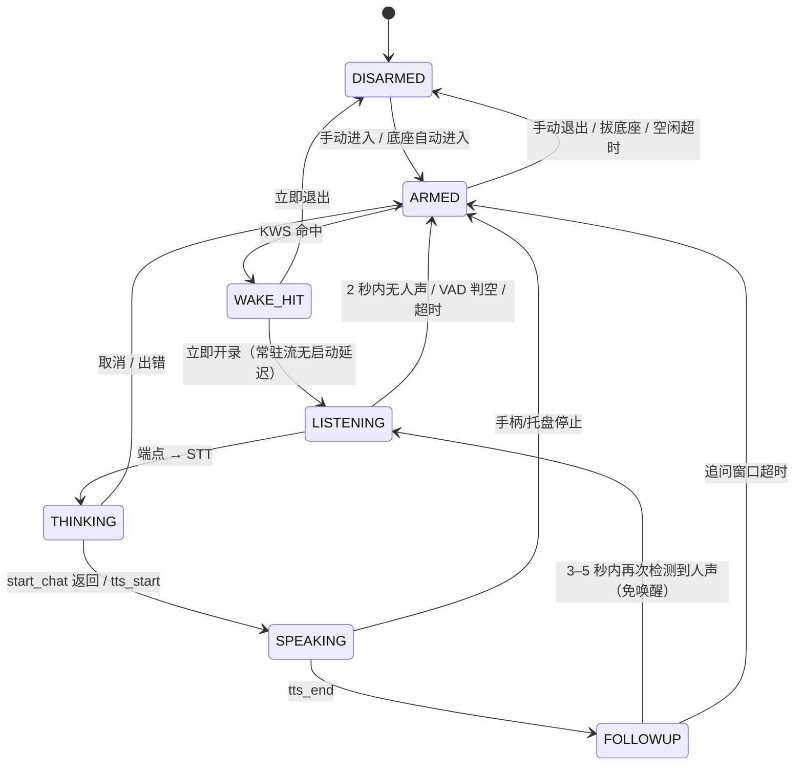

# 智能音箱模式（声控唤醒 + 眼睛界面）方案

> 规划稿 · 2026-11-07 · **未改任何代码**
> 证据标记：`[有来源]` 指代码、官方文档或公开资料；`[推测]` 指没有实测的量级估计；`[未验证]` 指必须在 Steam Deck 上确认。
> 本文只回答"怎么做、值不值得做、先做哪一段"，不含实现代码。

---

## 0. 结论（先看这段）

**可行，而且现有基础比预期好。**

已经具备：

- 离线 STT：SenseVoice-Small int8，纯本机 CPU，不联网（[stt.py L1-L19](../server/stt.py#L1-L19)、[config L202-L215](../server/config.example.toml#L202-L215)）。
- 本机 TTS：piper-plus 女仆音色，逐句合成 + 播放，可停（[tts.py L895-L957](../server/tts.py#L895-L957)）。
- 全屏置顶窗口的成熟做法：overlay 用 X11 绕过窗口管理器、铺满整屏、单实例、看门狗，已经跑通（[overlay.py L327-L337](../server/overlay.py#L327-L337)）。
- 桌面客户端已有托盘、全屏状态处理、SDL 读手柄键（不抓取输入）（[client/main.py L566-L576](../client/main.py#L566-L576)、[L1142-L1165](../client/main.py#L1142-L1165)、[L1186-L1203](../client/main.py#L1186-L1203)）。
- 后端有 WS 广播和 `start_chat()`，语音文字可以走和打字完全相同的对话链路（[main.py L3473-L3495](../server/main.py#L3473-L3495)、[L7682-L7758](../server/main.py#L7682-L7758)）。

真正缺的是三块：

1. **后端没有常驻麦克风采集**：现在录音由前端 `getUserMedia` 做，后端只接收 WAV（[main.py L5133-L5150](../server/main.py#L5133-L5150)、[useVoiceInput.ts L2-L11](../plugin/src/useVoiceInput.ts#L2-L11)）。
2. **没有唤醒词和 VAD 状态机**：仓库里没有任何 wake / VAD / AEC 代码。
3. **TTS 没有"开始/结束"事件，而且等整段回复生成完才开口**（[main.py L5696-L5701](../server/main.py#L5696-L5701)、[tts.py L719-L760](../server/tts.py#L719-L760)）。眼睛界面无法知道"正在说/说完了"，语音首声也会被 LLM 整段生成时间拖长。

**推荐路线（一句话版）**：

> **sherpa-onnx KWS + silero VAD**（同一套运行时，模型约 10MB，中文唤醒词零成本自定义）放在**后端**；眼睛界面用**网页全屏页**，由现有桌面客户端承载；**半双工**（录音时静音外放，沿用现有 duck）；底座用**外接显示器 + 外部电源**判断，默认**手动进入**；v1 只承诺**桌面模式**。

**最大的风险不是延迟，是误唤醒把家庭对话转成文字发给云端 LLM**。当前 LLM 是 DeepSeek 远端接口（[config L88-L105](../server/config.example.toml#L88-L105)），语音识别本身在本机，但识别出的文字会进入同一轮对话。默认限制必须按第 7 节执行；"唤醒后是否直接发送"是第 11 节的首要决策项。

**体验上两个硬伤**：

- Deck 自带双麦在底座/TV 场景离用户远，且会收风扇、电视和房间噪声（[有来源](https://www.steamdeck.com/zh-cn/deck)、[有来源](https://geekchamp.com/steam-deck-has-a-surprisingly-great-microphone/)）。建议底座插 USB 麦克风，放在沙发侧；自带麦只适合桌面近距离。
- 现在 TTS 在整段回复结束后才开播（[main.py L5696-L5701](../server/main.py#L5696-L5701)）。智能音箱必须做**句级流式播报**，否则"说完→第一声"要等整段 LLM 输出，短问答也可能多等 1–3 秒。

---

## 1. 现状盘点（带文件行号）

### 1.1 STT：本地、离线，但录音不在后端

| 项 | 现状 | 对本功能的意义 |
| --- | --- | --- |
| 本地/远端 | 本地，纯 CPU，不联网 | 唤醒后的识别可以在设备内完成，音频不出机器 |
| 模型 | SenseVoice-Small int8：官方下载包约 1GB，只解出 int8 那份约 250MB，按需下载，带版权归属说明 | 中英混说可用；冷启动要加载，唤醒模式应预热 |
| 线程/卸载 | 2 线程；空闲 600 秒自动卸载（[stt.py L69-L73](../server/stt.py#L69-L73)、[L709-L739](../server/stt.py#L709-L739)） | 常驻监听时不能让模型反复装卸；进入音箱模式后保持预热 |
| 录音 | 前端用 WebAudio `ScriptProcessor` 收 PCM → 降采样到 16k → 单声道 16bit WAV，再 POST（[main.py L5133-L5150](../server/main.py#L5133-L5150)、[index.html L10829-L10832](../server/static/index.html#L10829-L10832)） | **后端没有常驻采集通道**；唤醒词需要新增 `pw-record` 常驻流 |
| 自动发送 | 不自动发送，识别文字只填进输入框（[main.py L5137-L5138](../server/main.py#L5137-L5138)、[index.html L10978-L10986](../server/static/index.html#L10978-L10986)） | 智能音箱要"直接对话"，需改为调用 `start_chat()` 或增加"自动发送"分支 |
| 延迟 | 官方口径 10 秒音频约 1–1.5 秒（[stt.py L1-L19](../server/stt.py#L1-L19)）；冷加载 1–3 秒 `[推测]` | 3–6 秒的短句目标 ≤1.2 秒；唤醒模式预热后可达 |
| 隐私 | 音频字节只进内存；开启 dev_mode 时识别文字会写进 devlog，最多 300 字（[stt.py L801-L803](../server/stt.py#L801-L803)） | 唤醒模式默认必须关闭文本日志；音频不落盘是现有优点，要保持 |
| 接口 | `/api/stt` 状态、`/api/stt/duck` 静音/恢复、`/api/stt/transcribe` 转写（[main.py L5074-L5150](../server/main.py#L5074-L5150)） | 可直接复用转写；缺 `/api/wake/*` |

### 1.2 TTS：能播，但没有状态事件

| 项 | 现状 | 对本功能的意义 |
| --- | --- | --- |
| 引擎 | piper-plus 主引擎，espeak-ng 兜底（[config L169-L200](../server/config.example.toml#L169-L200)） | 女仆音色可用；默认 `enable = false`，进入音箱模式前必须检查/强制开启 |
| 播放 | 逐句合成后 `pw-play` / `paplay` / `aplay` 播放，逐段 `await`（[tts.py L1077-L1147](../server/tts.py#L1077-L1147)、[L1149-L1174](../server/tts.py#L1149-L1174)） | TTS 内部首声只等第一句合成；但整段回复生成完才会进入 TTS（见下行） |
| sink | 先探测默认 sink 是否可用，10 秒缓存，按播放器能力传 `--target` / `PULSE_SINK`（[tts.py L1176-L1198](../server/tts.py#L1176-L1198)） | 眼睛模式若切到 AEC 虚拟 sink，要绕开这个默认探测 |
| 开始/结束事件 | **没有**。`speak()` 只在开始/结束写 devlog，不广播；`status()` 不含 `speaking`（[tts.py L895-L957](../server/tts.py#L895-L957)、[L719-L760](../server/tts.py#L719-L760)） | 必须补：`tts_start` / `tts_end`，或至少 `speaking` 字段 |
| 触发时机 | 整段回复结束后 `create_task(tts.speak(reply))`，不等待（[main.py L5696-L5701](../server/main.py#L5696-L5701)） | 首声晚于整段生成；需要句级流式 TTS |
| 打断 | `stop()` 可立即掐断；新的一次 `speak()` 会先 `await self.stop()`（[tts.py L895-L902](../server/tts.py#L895-L902)） | 手柄/托盘"停止"可行；语音 barge-in 仍需要 AEC + 流式 ASR |

### 1.3 overlay：窗口技术可复用，进程本身不要复用

| 项 | 现状 | 对本功能的意义 |
| --- | --- | --- |
| 形态 | 独立 PySide6 进程，xcb/XWayland，`FramelessWindowHint` + `WindowStaysOnTopHint` + `X11BypassWindowManagerHint`（[overlay.py L327-L337](../server/overlay.py#L327-L337)） | 这是"全屏黑眼睛"最可靠的置顶方式，可直接照搬 |
| 层级 | 绕过窗口管理器，不进任务栏，始终盖在普通窗口之上 | 桌面模式下能盖住桌面；游戏模式下不保证（见 4.3） |
| 铺屏 | 不走 `showFullScreen()`，直接 `setGeometry(screen().geometry())`（[overlay.py L658-L666](../server/overlay.py#L658-L666)） | 多屏时可选目标屏幕，适合"TV 显示眼睛、内屏不动" |
| 输入 | 遮罩本身接住点击；显示期间独占音量键节点，音量键改为"强制停止"（[overlay.py L1-L9](../server/overlay.py#L1-L9)） | Plan B 的独立进程可照搬"只抓退出键"；**不要 grab 整个键盘/手柄**，否则会挡住系统；网页宿主不需要 grab |
| 生命周期 | 后端按需拉起，单实例，100ms 轮询 `/api/overlay_state`，30fps 动画，300 秒看门狗（[main.py L6441-L6482](../server/main.py#L6441-L6482)、[L6623-L6674](../server/main.py#L6623-L6674)、[L6783-L6797](../server/main.py#L6783-L6797)） | 眼睛进程可复用同一套"单实例 + 轮询 + 看门狗"；但**不要复用同一个进程/状态**，否则会与工具操作的遮罩语义互相打架 |
| 鉴权 | 遮罩进程走回环，`/api/overlay_state` 对回环免令牌 | 眼睛进程同样可以轮询本地接口，不需要额外配对 |

### 1.4 power：只抑制桌面模式，游戏模式故意不管

| 项 | 现状 | 对本功能的意义 |
| --- | --- | --- |
| 模式判断 | `desktop_mode()` 用 PipeWire 里有没有 gamescope 视频节点（[power.py L54-L65](../server/power.py#L54-L65)、[tools.py L2237-L2250](../server/tools.py#L2237-L2250)） | 和 `get_status()` 共用判据，不会两套结论 |
| 抑制 | 按"原因"计数持有时才真正挂 `systemd-inhibit` + KDE 息屏 cookie（[power.py L96-L115](../server/power.py#L96-L115)、[L193-L215](../server/power.py#L193-L215)） | 眼睛模式要新增一个原因（如 `wake_mode`），并确保持有期间不释放 |
| 关键限制 | `_reconcile()` 里是 `wanted and enabled and _refresh_mode()`（模式判定即桌面模式，[power.py L177-L186](../server/power.py#L177-L186)） | **游戏模式下即使 hold 也不会生效**。v1 只做桌面模式的话没问题；要做游戏模式必须改这一条 |
| 配置 | `[power] keep_awake = true`，注释明确"游戏模式完全不干预"（[config L152-L155](../server/config.example.toml#L152-L155)） | 与现状一致，不要偷偷改全局行为 |

### 1.5 client：托盘、全屏、手柄键都有现成的

| 项 | 现状 | 对本功能的意义 |
| --- | --- | --- |
| 窗口 | `QWebEngineView`，默认 1240×760 普通窗口，加载 `http://127.0.0.1:18765/?native=1`（[client/main.py L1142-L1165](../client/main.py#L1142-L1165)） | 眼睛页可以直接在同一个 view 里切层，再 `showFullScreen()` |
| 麦克风授权 | 自动授予 `MediaAudioCapture`（[client/main.py L1064-L1106](../client/main.py#L1064-L1106)） | 现有语音输入可用；但唤醒模式的录音应改为后端常驻，不依赖页面 |
| 全屏 | 托盘 `restore()` 已处理 `isFullScreen()`，全屏时只提窗不还原（[client/main.py L1190-L1198](../client/main.py#L1190-L1198)） | 已经有"全屏状态"的意识，改动风险低 |
| 手柄 | `R1Trigger` 用 SDL2 只读、不 grab，游戏模式下也能读到虚拟 X360 手柄；但事件只在窗口激活时转发网页（[client/main.py L566-L576](../client/main.py#L566-L576)、[L1167-L1184](../client/main.py#L1167-L1184)） | 眼睛模式退出键（B/A）应直接由客户端处理，不依赖窗口焦点 |
| 托盘 | 已有最小化/恢复/单实例唤起（[client/main.py L1186-L1210](../client/main.py#L1186-L1210)） | "退出智能音箱模式"直接加托盘菜单；不需要新进程 |
| 多屏 | 没有显式的目标屏选择逻辑 | 需要新增：优先外接屏，其次当前屏；配置 `auto/internal/external` |

### 1.6 录音通路归属

- 桌面客户端和 Decky 插件都在**前端**录音：插件用 `getUserMedia`，因为插件跑在游戏模式、能直接拿到麦克风（[useVoiceInput.ts L2-L11](../plugin/src/useVoiceInput.ts#L2-L11)）；客户端网页同样用 `getUserMedia`（[index.html L10829-L10832](../server/static/index.html#L10829-L10832)）。
- 后端只接收 WAV，不做实时采集；`record_supported()` 只检查 `pw-record`/工具是否存在（[stt.py L811-L820](../server/stt.py#L811-L820)）。
- 插件以 root 运行，但后端是以 `deck` 身份起的，并且显式补了 `XDG_RUNTIME_DIR`，注释里已经写明"后端的 `pw-record`（语音录音）和 PipeWire 抓帧都得靠它"（[plugin/main.py L826-L853](../plugin/main.py#L826-L853)）。
- **结论：唤醒词应落在后端进程**。理由：后端在宿主运行期间一直常驻，而且同时拥有 STT/TTS/对话/WS；客户端只在桌面模式存在，插件只在游戏模式存在，都不适合作为唯一宿主。前端页面在唤醒模式下不应该再持有麦克风。
- 注意：后端**不是** systemd 服务，只由客户端和插件拉起（[README L130](../README.md#L130)）。所以"常驻监听"只在宿主（客户端或插件）运行期间成立；宿主退出，监听必须一起停。这也意味着"眼睛模式必须有客户端或插件在场"，不能做成开机即听的独立服务。

### 1.7 WS 事件：能驱动"思考"，不能驱动"说话"

| 状态 | 现有来源 | 可用性 |
| --- | --- | --- |
| 思考中 | `status.data.running`、`thought_start`、`stream_start`（[main.py L1830-L1860](../server/main.py#L1830-L1860)、[L7045-L7059](../server/main.py#L7045-L7059)、[L7101-L7110](../server/main.py#L7101-L7110)） | 可直接驱动"眼睛向上看/慢眨" |
| 思考结束 | `stream_start` / `assistant_message` / 最终 `status running=false` | 可用，但有多个路径，建议由 wake 状态机统一收口 |
| 说话中 | **无**。`assistant_message` 先到，`tts.speak()` 之后才异步播放（[main.py L5696-L5701](../server/main.py#L5696-L5701)） | 必须新增 `tts_start` / `tts_end` 或 `speaking` 字段 |
| 聆听中 | **无** | 新增 wake 状态机事件/字段 |
| 唤醒 | **无** | 新增 |

`start_chat()` 是可复用的入口，但它不接受"语音来源"的语义；建议给 wake 轮次传 `client="wake"` 之类标识，既避开 QQ 通道"不本机播报"的判断（[main.py L5699-L5701](../server/main.py#L5699-L5701)），也方便审计区分。

### 1.8 缺口汇总

| # | 缺口 | 影响 | 优先级 |
| --- | --- | --- | --- |
| 1 | 后端常驻采集（`pw-record` 常驻流 + 环形缓冲） | 没有它就没有唤醒 | P1 |
| 2 | 唤醒词 + VAD 状态机 | 没有它只能按键说话 | P1 |
| 3 | TTS `tts_start` / `tts_end` / `speaking` | 眼睛无法正确显示"说话中"，也无法做防自激 | P2 |
| 4 | 句级流式 TTS | 首声被整段生成拖慢 | P2/P3 |
| 5 | 语音轮次自动发送 + 强制 TTS | 现在只填输入框、且 TTS 可能默认关闭 | P2 |
| 6 | 眼睛全屏页 + 目标屏选择 | 没有界面载体 | P2 |
| 7 | 底座检测 + 自动进入 + 电源抑制 | 只能手动开关 | P3 |
| 8 | 唤醒模式的会话/日志隐私策略 | 误唤醒可能把对话写进历史/日志 | P2/P3 |
| 9 | 游戏模式的眼睛宿主 | 游戏模式无法保证覆盖 | P4 |

---

## 2. 唤醒引擎选型

### 2.1 逐项对比

| 引擎 | 许可证 | 是否需要联网 | 自定义唤醒词成本 | 中文 | Deck（x86_64/SteamOS）安装 | 常驻 CPU 量级 | 结论 |
| --- | --- | --- | --- | --- | --- | --- | --- |
| **sherpa-onnx KWS** | 代码 Apache-2.0；模型许可需按具体模型核查（zh-en 3M 用 WenetSpeech L 训练）`[未验证]` | 完全离线 | **零成本**：改 `keywords_raw.txt`，用 `text2token` 生成拼音/phone 序列，不重训模型 | 中英混合 | **已经装了**（`requirements-stt.txt` 第 3 行） | 1–4% 单核 `[推测]` | **推荐主选** |
| openWakeWord | 代码 Apache-2.0；预训练模型 CC BY-NC-SA 4.0（**非商用**）；商用 $150/唤醒词 | 离线推理（训练可上云） | 自训需要合成数据/训练流程；或买现成训练 | 英文为主，中文自定义效果不稳 | `pip install openwakeword` + onnxruntime | 1–3% 单核 `[推测]` | 备选（英文唤醒词 / 非商用场景） |
| Porcupine | 专有；Free 计划 **strictly non-commercial**；商用 Foundation $6,000/年起 | 需要 AccessKey；运行时基本离线 | 控制台秒级训练，最省事 | 多语言，中文可用 | `pip install pvporcupine`（有 linux x86_64 wheel） | <1–2% 单核 `[推测]` | 只在有商业授权预算时考虑 |
| Vosk KWS | Apache-2.0 | 完全离线 | 改关键词文本，零训练 | 中文 | `pip install vosk` + 中文小模型约 42MB | 5–10% 单核 `[推测]` | 备选，但不优先 |

补充：

- **sherpa-onnx KWS 的关键数据**（[有来源](https://k2-fsa.github.io/sherpa/onnx/kws/pretrained_models/index.html)）：`sherpa-onnx-kws-zipformer-zh-en-3M-2025-12-20` 解包约 38MB，其中运行所需的 int8 encoder 4.4MB + decoder 743K + joiner 85K + `tokens.txt` + `en.phone` 3.2MB，合计约 **8.5–10MB**；`chunk_size=8` 延迟 160ms，`chunk_size=16` 延迟 320ms，**延迟越低通常准确率越低**，需要实机二选一。
- **自定义中文唤醒词**：官方例子就是把"周望军 / 文森特卡索"这类词转成拼音 token，`--tokens-type phone+ppinyin`，不需要训练（[有来源](https://k2-fsa.github.io/sherpa/onnx/kws/pretrained_models/index.html)）。这对"梅朵"这类自造词很友好。
- **VAD**：sherpa-onnx 自带 silero VAD（`VoiceActivityDetector`），模型约 2MB，可以把 KWS 和 VAD 都塞进同一套运行时，不新增依赖（[有来源](https://pypi.org/project/sherpa-onnx/1.13.2/)）。
- **Porcupine 的许可**：Free 计划明确"Strictly Non-Commercial"，商用 $6,000/年起（[有来源](https://picovoice.ai/pricing/)）；AccessKey 是必需的（[有来源](https://picovoice.ai/docs/porcupine/)）。
- **openWakeWord 的许可**：代码 Apache-2.0，但预训练模型是 CC BY-NC-SA 4.0；商用要按 $150/唤醒词买许可（[有来源](https://pypi.org/project/openwakeword/)、[有来源](https://openwakeword.com/license)）。

### 2.2 唤醒词建议

- 用 **3–4 个音节**，不要用 2 个字。KWS 对短词的区分度差，误触发率会明显上升。
- 候选：`你好梅朵`、`梅朵梅朵`、`嘿梅朵`。
- 同一个模型可以同时放 2–3 个候选词做 A/B，实机各跑 1–2 小时，记录"成功唤醒率 / 每小时误触发次数 / 电视开着时的误触发"，再定最终词。
- 不要把"梅朵"单独作为唤醒词；它是角色名，日常对话里出现概率不低。

### 2.3 选型结论

- **主选：sherpa-onnx KWS（chunk-8 优先，准确率不够再换 chunk-16）+ silero VAD**。零新增运行时、模型极小、中文自定义免费、和现有 STT 共用 `onnxruntime`。
- **备选：openWakeWord**。如果用户更想要英文唤醒词（如 "Hey Meido"），或者愿意接受非商用许可，它是最省事的英文方案。
- **不推荐作为主选：Porcupine**（许可成本/分发限制）、**Vosk KWS**（短词准确率和 CPU 都不占优）。
- **合理区间**：常驻监听总 CPU <5% 单核；唤醒判定延迟 <0.5 秒；常驻内存（KWS + VAD + 2 秒环形缓冲）<100MB。超过这个区间就要降级（换 chunk-16、降采样、减少线程）。

---

## 3. 回声、半双工与打断

### 3.1 两条方案

| 维度 | 半双工（推荐 v1） | 全双工（AEC） |
| --- | --- | --- |
| 做法 | 唤醒后先静音外放（复用 `audiomute.duck`），录完恢复；TTS 播放期间暂停采集 | 用 PipeWire `module-echo-cancel`（WebRTC AEC）建虚拟 source/sink；TTS 走虚拟 sink，采集走虚拟 source |
| 现有基础 | `duck`/`restore` 已实现，带引用计数和 90 秒自动恢复兜底（[audiomute.py L99-L154](../server/audiomute.py#L99-L154)、[L24](../server/audiomute.py#L24)） | 无；需要运行时加载模块、改采集/播放目标 |
| 体验 | 不能边说边听；不能打断长回答；说完后可以开 3–5 秒追问窗口 | 可以边播边听，理论上可做 barge-in |
| 风险 | 低；只是"闭麦" | 中高：AEC 效果依赖扬声器/麦克风位置、房间反射；全局虚拟设备会影响其他应用；SteamOS 上是否可用要实测 |
| 推荐 | **v1 采用** | **P4 实验，不作为承诺** |

`duck` 的行为是"静音默认输出"，不是"压低音量"；它在第一个录音时真正静音，之后按计数恢复，录音前本来就静音的话不会擅自打开（[audiomute.py L99-L154](../server/audiomute.py#L99-L154)）。智能音箱模式要额外做两件事：

1. **TTS 前必须 `restore()`**，否则说话没声音；顺序是 `duck → 录 → restore → TTS`。
2. **TTS 期间暂停采集**，避免自己的声音被 KWS/VAD 当成新输入，形成自激循环。

### 3.2 半双工的体验损失有多大

- 对"问一句、答一句"的智能音箱，损失**很小**：典型回答 5–10 秒，用户本来也不会在回答中间插话。
- 真正的损失是：**长回答不能打断**、**不能在它说话时追加条件**、**不能用语音说"停"**。
- 可接受的补偿：手柄 B 键 / 托盘"停止" / Esc 立即 `tts.stop()`；回答结束后的 3–5 秒追问窗口，用户可以直接接着说，不用再喊唤醒词。
- 不建议在 v1 承诺"语音打断"，因为那需要同时具备 AEC、流式 ASR 和可追加的 TTS 队列，当前三者都不满足。

### 3.3 barge-in 是否现实

**不现实（v1）。** 需要同时满足：

1. **AEC**：把 TTS 的参考信号从麦克风里消掉。PipeWire 的 `module-echo-cancel` 提供 WebRTC 方法（[有来源](https://docs.pipewire.org/1.2/page_module_echo_cancel.html)），但需要把 TTS 路由到虚拟 sink，属于系统性改动；SteamOS 上是否稳定要实测 `[未验证]`。
2. **流式 ASR + endpointing**：现在是"整段 WAV → 一次性转写"（[main.py L5133-L5150](../server/main.py#L5133-L5150)），没有边说边出字。
3. **可追加/可打断的 TTS**：现在 `speak()` 一进来就 `await self.stop()`（[tts.py L895-L902](../server/tts.py#L895-L902)），适合"整段替换"，不适合"边说边插话"。

结论：**v1 半双工 + 手柄/托盘手动打断**；P4 再决定要不要投入 AEC 和流式 ASR。

### 3.4 状态机草案



关键约束：

- `LISTENING` 期间外放必须静音（半双工），`SPEAKING` 期间采集必须暂停。
- `SPEAKING` 的结束以 `tts_end` 为准，不能以 `assistant_message` 为准。
- 任何状态下收到"退出"都要能回到 `DISARMED`，并释放采集进程/恢复音量。

---

## 4. 眼睛界面形态

### 4.1 三条路对比

| 方案 | 层级/置顶 | 能否盖住游戏 | 输入处理 | 退出方式 | 改动面 | 复用性 | 结论 |
| --- | --- | --- | --- | --- | --- | --- | --- |
| **A. 客户端原生全屏窗口**（QWidget/QPainter） | Qt 置顶 + 全屏，桌面可靠 | 不能 | 自己处理键盘/手柄 | Esc/托盘/手柄 | 中：新窗口 + 动画代码 | 游戏模式不能复用 | 备选 |
| **B. 现有 overlay 进程** | X11 绕过 WM，桌面可靠 | `[未验证]`，依赖 gamescope/XWayland | 已有"独占输入 + 音量键停止" | 点击/音量键/托盘 | 小：改现有遮罩 | 与工具遮罩语义冲突 | **不推荐**直接复用 |
| **C. 网页全屏页（客户端承载）** | QWebEngineView `showFullScreen()`，桌面可靠 | 不能（游戏模式另用 Decky 大屏页） | 页面 JS + 客户端托盘/手柄 | Esc/托盘/手柄/拔底座 | 小：一个页面层 + 状态字段 | 同一套 JS 可给 Decky 大屏页复用 | **推荐** |

### 4.2 推荐：C（网页全屏页，现有客户端承载）

理由：

- 现有客户端就是 `QWebEngineView`，页面已经是同一个前端；加一个全屏 `eyes` 层比新开一个原生窗口便宜。
- 客户端已经处理了 `showFullScreen()` 和托盘恢复（[client/main.py L1190-L1198](../client/main.py#L1190-L1198)），托盘、单实例、麦克风授权都在。
- 动画是 canvas/CSS，60fps 的简单眼睛对 Deck 的 WebEngine 压力很小；不需要第二个 WebEngine 进程，也不需要新进程。
- 同一套 `eyes.js` 可以后面塞进 Decky 大屏页（GamepadUI 路由，[README L48](../README.md#L48)），游戏模式复用同一份视觉，不用重写。

需要新增的只有：

1. `server/static/eyes.js`（或页面内的一层）——黑底 + 眼睛状态机 + canvas 动画。
2. 客户端在进入模式时：选目标屏 → `showFullScreen()` → 页面切到 eyes 层；退出时还原窗口。
3. `GET /api/wake/state`（回环免令牌，10Hz 轮询）返回 `state / level / wake_count / docked / target_display`，由眼睛页轮询；不需要新 WS 连接。
4. 退出键：页面 Esc、托盘"退出智能音箱模式"、客户端 SDL 读手柄 B/A（不依赖窗口激活）、拔底座自动退出。

**为什么不是 A**：动画代码要重写一份，游戏模式完全不能复用；置顶能力虽然更好，但智能音箱场景下屏幕本来就是全屏黑的，不需要"盖住其他应用"的强置顶。

**为什么不是 B**：overlay 的进程、状态和轮询端点都是围绕"agent 正在操作设备"设计的；复用会让"点一下取消"与"眼睛模式"互相污染，而且它的 X11 置顶在游戏模式并不可靠。

### 4.3 层级与游戏模式

- **桌面模式**：全屏 QWebEngineView 盖住桌面，KDE 面板在全屏时自动隐藏；这是 v1 的场景。
- **游戏模式**：按 Steam 官方说明，接外接显示器时内屏会黑，且游戏模式只支持单屏（多屏要回桌面模式）[有来源](https://help.steampowered.com/en/faqs/view/4C18-08B5-DEC9-3AF4)。此时客户端不在运行，眼睛页应由 Decky 大屏页承载；**大屏页在 Steam UI 路由内，不能可靠盖住正在运行的游戏**，所以 v1 不承诺"边玩游戏边显示眼睛"。
- **不要**为了眼睛模式自动从游戏模式切桌面模式；那会打断游戏，属于毁体验。

### 4.4 眼睛的状态与视觉

建议只有 6 个状态，全部用眼睛表达，**不显示文字**（也符合"画面顶部不显示文字"的偏好）：

| 状态 | 眼睛表现 | 触发 |
| --- | --- | --- |
| 待机/已武装 | 半睁、慢眨（3–7 秒一次）、很暗 | 模式开启且未唤醒 |
| 唤醒 | 快速睁大 + 一次眨眼；可选极短的"叮" | KWS 命中 |
| 聆听 | 瞳孔轻微漂移 + 随麦克风电平放大/缩小 | VAD 检测到人声 |
| 思考 | 视线向上/向右缓慢移动，眨眼变慢 | STT 完成 → LLM 首字前 |
| 说话 | 瞳孔做轻微脉冲/收放，不是真口型 | `tts_start` → `tts_end` |
| 错误/离线 | 眼睛闭上或变成两条短横线 | 采集失败/TTS 不可用/后端断开 |

其它细节：

- 纯黑 `#000` 背景；眼睛用柔和的青或暖白，亮度不要拉满；OLED 内屏/OLED TV 都要避免静止高亮块。
- 5 分钟无交互自动"闭眼"，15–30 分钟无交互自动退出模式（省电 + 防烧屏）。
- 隐藏鼠标指针；不要显示任何按钮、标题、提示条。
- 多屏：默认外接屏；没有外接屏就用当前屏。配置 `eyes_display = auto | internal | external`。

### 4.5 备用宿主（客户端不在时）

如果用户希望"客户端没启动也能进入眼睛模式"，做一个极小的 `eyes.py` 进程，**只复用 overlay 的窗口做法**（X11 绕过 WM、铺满目标屏、单实例、看门狗），不复用它的状态机。这样不依赖 WebEngine，代价是动画要用 QPainter 再写一份；建议放到 P4，不影响 v1。

---

## 5. 底座触发

### 5.1 可用的判据

| 判据 | 读取方式 | 可靠性 | 说明 |
| --- | --- | --- | --- |
| 外接显示器已连接 | `/sys/class/drm/card*-*/status`，排除 `eDP`/`DSI`/`LVDS` | 高，且便宜 | HDMI/DP 连接就是"接了电视/显示器" |
| 外部电源在线 | `/sys/class/power_supply/BAT1/status` 不是 `Discharging`，或 `AC*/online = 1`（现有 `get_status` 已经在读 BAT1，[main.py L1830-L1832](../server/main.py#L1830-L1832)） | 中 | 普通充电器也会供电，不能单独用；电池充满时状态不一定是 `Charging`，所以看"是否在放电"更稳 |
| 桌面/游戏模式 | `tools.mode_is_gaming()`（[tools.py L2237-L2250](../server/tools.py#L2237-L2250)） | 高 | 决定眼睛能否用客户端承载 |
| Steam "docked" 状态 | 没有稳定文件/API | 低 | **不要**依赖 |

### 5.2 进入方式

- **默认手动**：托盘菜单 / 设置页 / 插件按钮"进入智能音箱模式"。原因：自动进入的误触发代价高（盖住屏幕、开始监听），而且用户不一定每次插底座都想用它。
- **可选自动**：只有同时满足才进入：
  1. `eyes_display` 找到外接屏；
  2. 外部电源在线（`BAT1/status != Discharging` 或 `AC*/online = 1`）；
  3. 当前是桌面模式；
  4. 没有正在跑的对话（`status.running == false`）；
  5. 条件稳定 5–10 秒（防抖）。
- **自动退出**：外接屏断开、拔掉充电、启动游戏、按 Esc/托盘/手柄 B、空闲超时。
- **冷却**：用户手动退出后 10 分钟内不再自动进入。

### 5.3 误触发怎么防

- 自动进入默认 **关闭**；打开时也只允许桌面模式。
- 进入前静音/停止任何正在播放的 TTS（避免刚插上就开口）。
- 进入后前 10 秒不响应唤醒词（避免底座插拔的电流声、系统提示音误触发）。
- 唤醒后 2 秒内没有检测到人声 → 回到待机，不转写、不发送。
- 同一唤醒词 20 秒内只接受一次。
- 屏幕锁定/睡眠状态不自动进入。
- 夜间静音时段（可选）：只亮眼睛、不发声，或直接不自动进入。

---

## 6. 延迟与功耗预算

### 6.1 延迟拆解（说完 → 第一声）

| 段 | 现状/新增 | 目标 | 说明 |
| --- | --- | --- | --- |
| 唤醒检测（说完唤醒词 → 判定） | 新增 | ≤0.4 秒 | KWS chunk-8 160ms / chunk-16 320ms，加 1–2 帧 trailing blanks；chunk-8 准确率更低则换 chunk-16 |
| 进入聆听（判定 → 开始收） | 新增 | ≤0.1 秒 | 常驻 `pw-record` 已经在流，不需要重新开设备 |
| 说话结束 → 端点 | 新增 VAD | ≤0.8 秒（0.6–1.0） | `min_silence` 0.5–0.8 秒；太短会截句，太长会拖 |
| STT | 现有 | ≤1.2 秒（3–6 秒语音） | 冷加载 1–3 秒；唤醒模式要预热，避免首轮慢 |
| LLM 首字节 | 现有远端 | ≤2.0 秒 | 网络依赖；DeepSeek 通常 0.5–2 秒 `[推测]` |
| TTS 首帧 | 现有 | ≤0.6 秒 | piper 首句合成 + 播放器启动；首句按标点切分、上限 300 字（[tts.py L533-L563](../server/tts.py#L533-L563)） |
| **合计（说完 → 第一声）** | 新增 | **P50 ≤3.5 秒，P90 ≤5.5 秒** | 短问答目标；长回答必须靠句级流式 TTS 才能压住 |

**最关键的一条优化**：现在 TTS 等整段回复生成完才开播（[main.py L5696-L5701](../server/main.py#L5696-L5701)）。智能音箱应改成**按句流式播报**：LLM 每吐出一个完整句子就入 TTS 队列，第一句说完就开始播。这样"首声"只受第一句生成时间影响，而不是整段。

配套：

- 进入音箱模式时预热 STT 和 TTS（避免首次加载 1–3 秒）；退出时再按现有空闲策略卸载。
- VAD 端点不要设得太激进；0.5 秒静音对手指/呼吸声更稳。
- 唤醒模式的 TTS 要强制开启（`force=True` 或进入前检查 `[tts] enable`），否则会出现"眼睛动了但没声"。

### 6.2 功耗预算

| 项 | 估算 | 目标 |
| --- | --- | --- |
| KWS（int8 3M，1–2 线程） | 1–4% 单核 `[推测]` | <5% |
| VAD（silero，同一运行时） | <1% 单核 `[推测]` | <1% |
| `pw-record` 16k 单声道常驻 | 1–2% 单核 `[推测]` | <2% |
| 常驻合计 | 3–7% 单核，约 +1–2W `[推测]` | <10% 单核，+3W 以内 |
| 温度/风扇 | +2–4°C，风扇低速或停 `[推测]` | 无可闻变化 |

必须实测，不能拍脑袋。建议的 A/B：

- A：进入音箱模式 30 分钟，屏幕亮度固定，不充电；
- B：同样条件但不启用监听；
- 记录：`pidstat`、`top -H`、hwmon 温度/风扇、`BAT1/energy_now` 差值、`powerprofilesctl`。

可用的命令（在 Deck 上执行，不改仓库）：

```
pidstat -p $(pgrep -f 'server.main:app') 1 30
top -H -p $(pgrep -f 'server.main:app')
cat /sys/class/hwmon/hwmon*/temp*_input
cat /sys/class/hwmon/hwmon*/fan*_input
cat /sys/class/power_supply/BAT1/energy_now
powerstat -d 0 1 1800
```

另外要测 8 小时过夜误唤醒次数（电视关/开两种），这比 CPU 更能决定体验。

---

## 7. 隐私与安全

### 7.1 当前数据流（必须先说清楚）

| 数据 | 现状 | 唤醒模式需要 |
| --- | --- | --- |
| 原始音频 | 前端录完一次性 POST，后端只在内存里转写；不落盘（[main.py L5133-L5150](../server/main.py#L5133-L5150)） | 常驻流只保留 1.5–2 秒环形缓冲，**绝不落盘** |
| 识别文字 | 只填输入框，不自动发送（[main.py L5137-L5138](../server/main.py#L5137-L5138)） | 自动发送会把文字送进当前会话与 LLM |
| 会话历史 | 持久化到 sessions | 建议唤醒模式默认**不落盘**或独立会话，退出即清 |
| devlog | dev_mode 开启时识别文字最多 300 字（[stt.py L801-L803](../server/stt.py#L801-L803)） | 唤醒模式默认**关闭文本日志**，只记次数/置信度 |
| LLM | 远端 DeepSeek（[config L88-L105](../server/config.example.toml#L88-L105)） | 文字会离开设备；除非用户换成本地模型 |
| TTS 输出 | 临时 WAV，播完即删 | 不受影响 |

**关键结论**：音频本身不出设备；但**误唤醒后如果自动发送，家庭对话的"文字"会到云端 LLM**。这是最需要设计的地方。

### 7.2 默认限制（建议直接写进默认配置）

1. 唤醒模式默认**关闭**；进入必须显式操作或显式打开自动进入。
2. 唤醒检测完全本地；不联网、不调用任何云 API。
3. 原始音频只留 1.5–2 秒内存环形缓冲，唤醒后才开始"正式录音"，上限 15 秒，超时丢弃。
4. 唤醒后 2 秒内无人声 → 丢弃，不转写、不发送。
5. 转写结果过短（<0.4 秒语音或 <2 个有效字）→ 不发送。
6. `wake` 相关的 devlog 默认只记 `wake_count / confidence / duration`，**不记文字**。
7. 唤醒模式默认使用独立会话，退出即清（或 24 小时内自动清），不写进长期记忆。
8. `/api/wake/*` 只允许回环访问；**即使开了 LAN 配对，也不允许远程端打开监听**。
9. 没有任何接口能取回原始音频；没有调试落盘开关，或把它放在 dev_mode 下并明确警告。
10. 进入模式时屏幕上有明确的"聆听"视觉状态；退出后立即释放麦克风进程。

### 7.3 误唤醒外发的防线

按强度从高到低，建议至少做前三条：

1. **两道门**：KWS 置信度 + VAD 确认真实人声 + 最短时长；三者都过才转写。
2. **先显示后发送（可选的隐私默认）**：识别文字先在眼睛界面/输入框显示 1–2 秒，用户可取消。代价是每次多一步；列为决策项。
3. **短窗口**：唤醒后只接受 5 秒内的第一段话；没有明确的"继续"就结束。
4. **会话隔离**：wake 会话不参与长期记忆，退出即清。
5. **可审计**：只记录"何时唤醒、置信度、时长、是否发送"，不记录内容；用户能查"今天误唤醒了几次"。
6. **硬件限制要诚实**：Deck 没有麦克风硬件静音开关；屏幕上"正在听"的指示是唯一保证。不要声称"绝对安全"。

### 7.4 许可证/合规

- sherpa-onnx 代码 Apache-2.0；KWS 模型要按具体模型核查（zh-en 3M 训练自 WenetSpeech L）`[未验证]`。个人使用没问题，分发前要确认。
- openWakeWord 预训练模型是 **CC BY-NC-SA 4.0**，商用要买 $150/唤醒词许可。
- Porcupine 免费计划仅非商用；商用 $6,000/年起。
- SenseVoice 的许可证与 attribution 已在 `stt.py` 头部注明（[stt.py L38](../server/stt.py#L38)），不要删。

---

## 8. 风险清单（按"会不会毁掉体验"排序）

| # | 风险 | 后果 | 缓解 |
| --- | --- | --- | --- |
| 1 | **误唤醒 → 家庭对话转成文字发给云端 LLM** | 信任崩塌，且无法挽回 | 两道门（KWS+VAD+最短时长）；唤醒后 2 秒无人声即丢弃；默认不记文字；独立会话退出即清；可选"显示后确认再发送"；审计只记次数 |
| 2 | **自激循环**：TTS 被自己的麦克风识别成新问题 | 无限对话、烧 token、吓人 | 半双工：TTS 期间暂停采集；TTS 前 `restore`、录前 `duck`；TTS 结束后 300ms 再开麦；追问窗口只在非播放时开启 |
| 3 | **电视/风扇/环境噪声** | 识别差、误唤醒、频繁失败 | 底座插 USB 麦放沙发侧；KWS 阈值调保守；VAD + 降噪；避免把 Deck 自带麦对着电视；实测电视开/关两套阈值 |
| 4 | **内置麦离用户太远（底座在电视旁）** | 3 米外唤醒率低、说话识别差 | 默认推荐 USB 麦克风；设置里可选输入设备；没有 USB 麦时明确提示"近距离使用" |
| 5 | **全屏黑 + 静止高亮眼睛导致 OLED/TV 烧屏、夜间刺眼** | 长期损伤/观感差 | 眼睛持续微动、亮度上限、5 分钟闭眼、15–30 分钟退出、纯黑背景 |
| 6 | **底座供电/过热/风扇** | 长时间充电 + 监听，温度上升、风扇可闻 | 实测 A/B；空闲自动退出；不在玩游戏时进入；温度异常自动退出 |
| 7 | **游戏模式覆盖冲突** | 盖不住游戏、或误盖 Steam UI | v1 不承诺游戏模式；自动进入只限桌面模式；检测到游戏启动立即退出 |
| 8 | **多人说话/方言/串音** | 识别成别人的话，或多人声混在一起 | v1 不做声纹分离；以第一段有效人声为准；文档明确说明；后续可加"只响应近场"的简单电平门限 |
| 9 | **客户端崩溃/黑屏卡死** | 屏幕全黑，用户不知道怎么退出 | 客户端看门狗/后端状态超时自动退出；托盘始终可退；手柄 B 全局可退；后端重启后强制清状态 |
| 10 | **麦克风被其他应用占用/设备切换** | 唤醒失效 | 采集进程崩溃自动重启（退避）；设备变化时重新选源；状态里明确报"麦克风不可用" |
| 11 | **许可证问题** | 不能分发/商用 | 选 sherpa KWS（Apache-2.0 代码）；分发前核查模型许可；避开 openWakeWord 预训练模型和 Porcupine 免费版 |

---

## 9. 可选路线与推荐

| 路线 | 内容 | 成本：改动面 | 额外成本：依赖/许可 | 体验 | 风险 | 可回退性 | 建议 |
| --- | --- | --- | --- | --- | --- | --- | --- |
| **A. 完整智能音箱** | 唤醒 + 自动对话 + 眼睛 + 底座自动 + 半双工 | 大：后端新模块、客户端页面层、power/dock、TTS 事件与流式 | 模型约 10MB；无新运行时；许可成本 0（若用 sherpa） | 最好 | 中（取决于是否自动发送） | 中 | **目标形态** |
| **B. 手动语音助手切片** | 手动进入模式 + 唤醒词只唤醒到"聆听" + 识别后填入/确认发送 + 眼睛只做状态 | 中：后端 wake.py + 眼睛页 + 托盘入口 | 同上 | 中上 | 低（不自动发送） | 高 | **先做这一版验证** |
| **C. 全双工进阶** | AEC + 流式 ASR + barge-in + 语音停止 | 很大：PipeWire 路由、流式识别、TTS 队列重构 | webrtc AEC / PipeWire 模块；调试成本高 | 最好 | 中高（回声/自激） | 低 | **P4 预研，不做 v1 承诺** |

**推荐**：以 **B 的切片起步**，每阶段都能独立验证；验证通过后按 A 收口。C 只在 P4 做一次技术验证（AEC 是否可用、barge-in 延迟是否可接受），不通过就明确不支持语音打断。

---

## 10. 分阶段落地计划

### P0：设备实测（不改仓库）

目标：把"能不能做"变成数字。

- 在 Deck 上跑 sherpa-onnx KWS + silero VAD 的官方示例（临时目录即可），用真实麦克风录 1–2 小时电视开/关的音频。
- 记录：成功唤醒率、每小时误触发、KWS+VAD CPU、内存、温度/风扇。
- 用现有 `/api/stt/transcribe` 测 3/5/10 秒音频的端到端延迟；用现有 TTS 测首帧。
- 测 `pw-record` 常驻流的启动延迟、设备切换行为。
- 通过标准：唤醒率 ≥95%（1 米内正常说话）、误触发 ≤1 次/小时（电视开着）、常驻 CPU <5% 单核、唤醒延迟 <0.5 秒。达不到就换 chunk-16 或换引擎。

### P1：后端常驻监听 + 手动开关（最小可用）

- 新增 `server/wake.py`：常驻 `pw-record` 流、2 秒环形缓冲、KWS+VAD、状态机、`/api/wake/toggle`、`/api/wake/state`。
- 先只做"唤醒 → 录音 → 转写 → 填入现有输入框/日志"，**不自动发送**；不做眼睛。
- 退出/关闭必须释放采集进程。
- 验证：手动开启后，喊唤醒词 3 次能有 3 次进入聆听；8 小时无音频落盘；关闭后 `pw-record` 进程消失；CPU 达标。

### P2：语音直连 + 眼睛页

- 转写结果调用 `start_chat()` 自动发送；wake 轮次强制 TTS；半双工 duck/暂停采集。
- 补 `tts_start` / `tts_end`（或 `speaking` 字段）；先做"整段播报"版本，不急着流式。
- 新增 `eyes.js` + 客户端全屏切换 + 目标屏选择 + Esc/托盘/手柄 B 退出。
- 验证：一次完整的"唤醒 → 提问 → 听到回答"不用碰屏幕；眼睛 6 个状态正确；Esc/托盘/手柄都能退出；杀掉后端后屏幕不会永久黑。

### P3：底座自动进入 + 电源 + 隐私收口

- 外接屏 + 外部电源检测；可选手动/自动；防抖/冷却；拔底座/启动游戏自动退出。
- `power.keeper.hold("wake_mode")`；桌面模式下保持常亮；空闲闭眼/退出。
- wake 会话隔离/不落盘；devlog 不记文字；`/api/wake/*` 只允许回环。
- 验证：插底座 10 秒内进入（若开启自动）、拔掉 10 秒内退出；2 小时不息屏；无自动误进入；日志里没有识别文字。

### P4：体验打磨/进阶（可选）

- 句级流式 TTS（第一句生成完就播），压缩首声延迟。
- AEC 实验：PipeWire `module-echo-cancel` 能否在 SteamOS 稳定工作；能则试"边播边听"，不能就明确不支持 barge-in。
- 游戏模式：Decky 大屏页承载同一套 `eyes.js`；确认能否盖住运行中的游戏，不能就不做。
- 备用 `eyes.py` 宿主（客户端不在时）；动画细节/音效/亮度策略。

每个阶段的共同验收：**任何一步失败都能退回上一阶段，不把麦克风永久打开、不把屏幕永久黑掉。**

### 10.1 接口与配置草案（只定形状，不写实现）

配置建议新增 `[wake]` 段（默认值按隐私优先）：

| 键 | 默认 | 说明 |
| --- | --- | --- |
| `enabled` | `false` | 总开关；关闭时不起采集进程 |
| `input_device` | `"default"` | PipeWire source 名；底座 USB 麦可在这里选 |
| `wake_words` | `["你好梅朵"]` | 可放 2–3 个候选做 A/B |
| `keywords_threshold` | `0.25` | 先用官方示例值，按误触发率调 |
| `chunk_size` | `8` | 8=160ms 延迟；准确率不够换 16 |
| `auto_dock` | `false` | 底座自动进入；默认关 |
| `eyes_display` | `"auto"` | `auto / internal / external` |
| `auto_send` | `true`（决策项） | 唤醒后直接发送；隐私优先可设 `false`（先显示再确认），见第 11 节 |
| `log_transcript` | `false` | 识别文字不写 devlog |
| `session_scope` | `"wake"` | 独立会话，退出即清 |
| `min_speech_ms` | `600` | 短于人声直接丢弃 |
| `max_utterance_sec` | `15` | 超时强制结束 |
| `followup_sec` | `4` | 回答后免唤醒追问窗口 |
| `idle_exit_min` | `15` | 无交互自动退出 |
| `volume_cap` | `40` | 进入时限制输出音量，退出还原；`null` 表示不改 |

接口建议全部**只允许回环**，且不提供任何"取回音频"的接口：

| 方法/路径 | 返回/作用 |
| --- | --- |
| `GET /api/wake/state` | `state / enabled / level / wake_count / docked / input_device / last_error`；眼睛页 10Hz 轮询 |
| `POST /api/wake/arm` | 进入模式（起采集、预热 STT/TTS、hold 电源） |
| `POST /api/wake/disarm` | 退出模式（停采集、恢复音量、释放电源 hold） |
| `POST /api/wake/toggle` | 托盘/设置页一键切换 |
| `POST /api/wake/stop` | 停止当前 TTS/取消当前轮次（不退出模式） |
| `POST /api/wake/exit` | 眼睛页 Esc / 手柄 B 用；等价于 disarm + 还原客户端窗口 |

---

## 11. 待用户决策的问题

| # | 问题 | 选项 | 建议默认 |
| --- | --- | --- | --- |
| 1 | 唤醒词用中文还是英文？用哪个词？ | `你好梅朵` / `梅朵梅朵` / `嘿梅朵` / "Hey Meido" | 先做 3 个中文候选 A/B；最终由用户定 |
| 2 | 唤醒后是否**直接发送**？ | 直接发送（最低延迟）/ 先显示 1–2 秒可取消 | 先做"直接发送"但保留开关；隐私优先时默认"先显示" |
| 3 | 智能音箱模式是否**落会话历史**？ | 正常持久化 / 独立会话退出即清 / 完全不落盘 | 独立会话、退出即清 |
| 4 | 进入方式 | 仅手动 / 底座自动（可关） | 手动默认；自动为可选 |
| 5 | v1 是否必须支持**游戏模式**？ | 只桌面 / 桌面+游戏 | 只桌面；游戏模式 P4 |
| 6 | 打断体验 | 接受半双工 + 手柄停止 / 必须语音 barge-in | 半双工；barge-in 不做承诺 |
| 7 | 麦克风 | Deck 自带麦 / 底座 USB 麦 | 推荐 USB 麦；没有则提示近距离使用 |
| 8 | 眼睛显示在哪块屏 | 自动（有外接用外接）/ 内屏 / 外接屏 | 自动 |
| 9 | 眼睛风格 | 极简几何 / 动漫风 / 写实 | 极简、低亮度、纯黑底 |
| 10 | 输出音量 | 沿用系统音量 / 进入时限制到 40% 并退出还原 | 限制上限，避免夜间突然大声 |

---

## 12. 只能等设备在线再测的结论

以下结论在 Windows 开发机上无法验证，P0 必须补测：

- KWS + VAD 在 Deck 上的实际 CPU、温度、风扇噪声、续航影响。
- Deck 内置双麦在底座/TV 场景的唤醒率与误触发率（尤其电视开着时）。
- 3–6 秒语音的 SenseVoice 端到端延迟（含冷加载）。
- piper-plus 首段合成 + 播放的实测首帧延迟。
- PipeWire `module-echo-cancel` 在 SteamOS 3.x 是否可用、AEC 效果如何。
- 游戏模式下 X11 眼睛窗口/Decky 大屏页能否盖住运行中的游戏。
- 后端以 `deck` 身份运行时 `pw-record` 能否稳定拿到内置麦/USB 麦。
- 外接显示器 sysfs 节点名（HDMI/DP）在官方底座和第三方扩展坞上的差异。
- 麦克风被 Steam/游戏/其他应用占用时的行为。

---

## 13. 外部参考

- sherpa-onnx KWS 预训练模型与自定义关键词（延迟 160/320ms、零训练自定义中文词）：https://k2-fsa.github.io/sherpa/onnx/kws/pretrained_models/index.html
- sherpa-onnx 包含 silero VAD：https://pypi.org/project/sherpa-onnx/1.13.2/
- openWakeWord 许可（代码 Apache-2.0，预训练模型 CC BY-NC-SA 4.0）：https://pypi.org/project/openwakeword/ ；商用许可：https://openwakeword.com/license
- Porcupine 定价与 AccessKey：https://picovoice.ai/pricing/ ；https://picovoice.ai/docs/porcupine/
- PipeWire Echo Cancel（WebRTC AEC）：https://docs.pipewire.org/1.2/page_module_echo_cancel.html
- Steam Deck 底座/外接屏行为：https://help.steampowered.com/en/faqs/view/4C18-08B5-DEC9-3AF4
- Steam Deck 内置双麦克风：https://www.steamdeck.com/zh-cn/deck
- Deck 内置麦的风扇/环境噪声问题：https://geekchamp.com/steam-deck-has-a-surprisingly-great-microphone/

---

## 14. P0 实现进度（2026-11-07）

用户已拍板：唤醒词 **「你好梅朵」**、**直接发送**、**只做桌面模式**、按推荐主线实现。
本轮完成最小可运行版本与对话链路；未在 Steam Deck 上运行过，"已验证"分两类：
开发机上的自动化测试，以及开发机上用**真实模型 + 真实 KWS/VAD** 做的自检（见 14.3）。

### 14.1 已落地

| 能力 | 文件 | 说明 |
| --- | --- | --- |
| 常驻唤醒服务 | [`server/wake.py`](../server/wake.py) | sherpa-onnx KWS + silero VAD；默认关闭；状态机 disarmed/armed/listening/thinking/speaking/error |
| 三道闸 | 同上 | KWS 阈值由 `keywords_threshold` 落到 `KeywordSpotter`；必须 VAD 判真人声；语音至少 `min_speech_ms`（默认 600ms）才转写/发送 |
| 半双工 | 同上 + [`server/audiomute.py`](../server/audiomute.py) | 检测到真人声才 `duck()` 一次；转写前 `restore()`；思考/播报期间采集只读不入队（`Capture.set_paused`），播报结束恢复 |
| 强制播报 | [`server/main.py`](../server/main.py) `handle_chat` | `force_tts=True` 时 `await tts.speak(reply, force=True)`，确保"读完才回监听"；QQ 通道仍不本机播报 |
| 播放状态 | [`server/tts.py`](../server/tts.py) | 新增 `set_state_listener` 与 `start/end` 回调，驱动眼睛的"播报中" |
| 唤醒接口 | [`server/main.py`](../server/main.py) | `GET /api/wake/state`、`POST /api/wake/toggle|stop|exit`，全部只允许回环访问；`toggle` 持久化 `[wake] enable` |
| 配置 | [`server/config.example.toml`](../server/config.example.toml) | 新增 `[wake]` 段：`enable=false`、唤醒词、阈值、设备、三道闸与追问窗口 |
| 眼睛界面 | [`server/static/eyes.html`](../server/static/eyes.html) | 纯黑全屏 + 双眼睛动画；0.4s 轮询状态；Esc/屏幕"停止""退出"；双击退出兜底；断线提示 |
| 客户端承载 | [`client/main.py`](../client/main.py) | 托盘新增「智能音箱模式」「停止聆听/播报」；进入时 `showFullScreen()` 加载 `/eyes.html`，离开时自动收回全屏 |
| 设置页开关 | [`server/static/index.html`](../server/static/index.html) | 语音设置区新增「智能音箱模式」开关，默认关闭；保存即热更新并自动进出监听 |
| 自动化测试 | [`tests/test_wake.py`](../tests/test_wake.py) | 覆盖三道闸、半双工引用、空识别、过短语音、TTS 状态、用户中止、模型报错、关闭状态、无音频落盘、命中后 `reset_stream` |
| 依赖 | [`requirements-stt.txt`](../requirements-stt.txt) | 增加 `sentencepiece`、`pypinyin`：`text2token` 生成唤醒词时必需 |

### 14.2 隐私与音频处理（实现口径）

- 唤醒前：每帧只喂 KWS，帧处理完即丢；内存里不保留历史，除非命中唤醒词。
- 唤醒后：只在检测到真人声时开始累积 PCM；`duck` 也是到这一刻才引用。
- 转写：PCM 在内存拼成 WAV 字节，直接交给 `stt.transcribe`；**不写任何音频文件**。
- 日志：只记录字数、唤醒次数、失败原因；**不记录识别文本**（`wake.transcribe` 只打 `chars`）。
- 上传：音频从不出设备；识别文字按现有 `start_chat → handle_chat → LLM` 链路走，LLM 仍是远端 DeepSeek。误唤醒的三道闸就是为了降低"家庭对话文字外发"的概率；用户主动开启开关即视为接受该链路。
- 现有 TTS 的临时 WAV（piper 合成中间文件）维持原有行为：写完立即删除（`tts.py` 的 `speak()` 路径），本轮没有新增任何临时音频文件。
- 接口权限：`/api/wake/*` 即使开了局域网配对也拒绝非回环来源；没有任何"取回音频"的接口。

### 14.3 已验证 / 未验证

已验证（开发机，`python -m unittest`）：

- 102 项相关测试全部通过（wake 12 项 + config/audiomute/tts 回归）。
- 三道闸：无真人声、语音过短、识别为空都不会调用对话或发送；KWS 未命中时连 duck 都不会引用。
- 半双工：每轮 `duck`/`restore` 各一次；用户中止会取消对话任务、停 TTS、恢复外放。
- 异常：转写报错进入 `error` 并保留原因，3 秒后自动回 `armed`；**启动就失败**（缺模型/缺 sherpa/麦克风被占）时停在 `error`，不会假装"监听中"。
- 音频：交给 STT 的是内存 WAV，模型目录没有产生 `.wav`。

已验证（开发机，真实模型 + 真实 KWS/VAD，2026-11-07 加测）：

| 项目 | 方法 | 结果 |
| --- | --- | --- |
| `text2token` 生成「你好梅朵」 | 真跑 `sherpa-onnx-cli`（模型自带 `tokens.txt`） | 生成 `n ǐ h ǎo m éi d uǒ @你好梅朵`，与官方示例格式一致 |
| KWS + VAD 加载 | `SherpaDetector.load()` 真加载 3M 模型与 `silero_vad.onnx` | 成功 |
| 唤醒命中 | 用本机 SAPI（Microsoft Huihui）合成「你好梅朵」逐帧喂入 | 阈值 0.10–0.25 均命中 1 次 |
| 非唤醒词 | 合成「今天天气不错…」、模型自带的「女儿」「法国」「文森特卡索」测试音频 | 单关键词「你好梅朵」下 0 次误命中 |
| 完整链路 | 真实 KWS+VAD + 假 STT/对话：唤醒→聆听→端点→`start_chat(force_tts=True, client="wake")`→追问窗口 | 状态按 `armed→listening→thinking→listening` 走通，未唤醒时 0 次发送 |

两种合成音频只用于验证"管线能跑、状态机正确"，**不代表真实人声唤醒率**；唤醒率/误触发仍必须上 Deck 用真人声测。

未验证（必须等 Deck 在线，见第 12 节）：

- KWS/VAD 的实际 CPU、温度、风扇、唤醒率与误触发率（3M 模型在多关键词并存时出现过跨词误命中，单关键词下未复现；真实噪声环境仍需实测）。
- `parec`/`pw-record` 在后端 `deck` 身份下能否稳定拿到内置麦/底座 USB 麦。
- 端到端延迟：唤醒→开口、TTS 首帧、说完到回监听。
- 桌面模式全屏覆盖、外接屏选择、Esc/托盘/触屏停止在真实窗口系统里的手感。

### 14.4 本轮验证发现并已修复的问题

| 问题 | 影响 | 修复 |
| --- | --- | --- |
| 命中后调用 `spotter.reset()`（正确名字是 `reset_stream()`） | **唤醒永远是 0 次**，异常被吞掉、界面一直显示"待机" | 改用 `reset_stream()`，并加单测管住该契约 |
| `sherpa-onnx-cli text2token` 缺依赖 | 生成唤醒词直接失败 | `requirements-stt.txt` 增加 `sentencepiece`、`pypinyin`；报错信息直说缺哪个 |
| CLI 不在 PATH 时找不到 | pip --user / Windows 商店版 Python 下生成失败 | `_cli_path()` 依次查 PATH、解释器目录、`sysconfig` scripts、用户脚本目录、`~/.local/bin`（含 `.exe`）|
| 启动失败后 3 秒自动回 `armed` | 眼睛显示"监听中"但实际没在听 | 只有组件真的起来了才允许自动回待机，否则停在 `error` |
| `toggle` 先写配置再启动失败 | 设置页停在"已开"、每次重启白试一次 | 启动失败时把 `[wake] enable` 退回 `false` 再返回 400 |

### 14.5 当前已知限制

- 模型准备在第一次打开开关时同步进行，可能需要几十秒；期间客户端会等待，眼睛页尚未提前出现。
- `eyes_display` 配置已预留，但客户端还没有把全屏窗口移动到指定显示器。
- 游戏模式未实现，也不承诺；在游戏内打开只会得到桌面窗口行为。
- barge-in（说话中打断）未实现：TTS 期间采集被暂停，必须用 Esc/托盘/停止区域。
- KWS 只输出命中词、不暴露置信度分数；阈值由 `KeywordSpotter` 内部执行，无法在界面上显示"这次有多像"。

